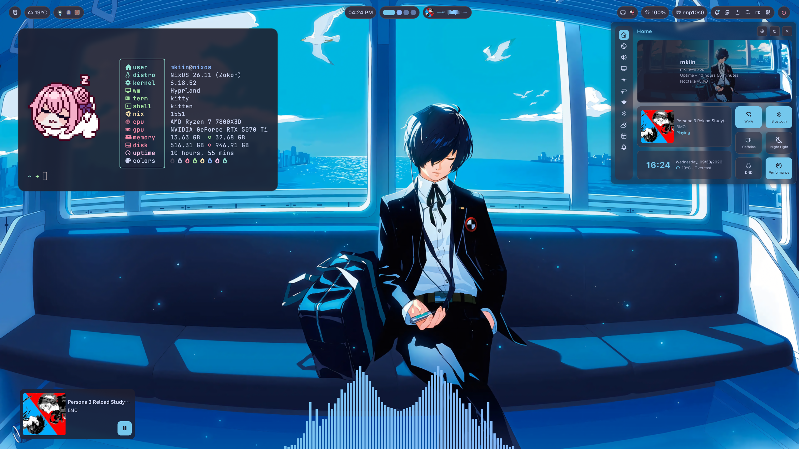
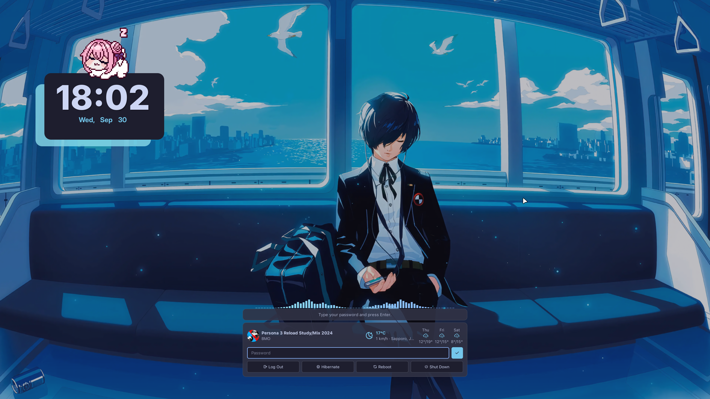

# dotfiles

My personal NixOS configuration, managed with Nix flakes and Home Manager.

The current setup targets my main desktop, `oregairu-yukino`, running NixOS with Hyprland.

## Stack

- NixOS
- Home Manager
- Hyprland
- Quickshell
- WezTerm
- Neovim
- agenix
- flake-parts
- treefmt

## Usage

Build the NixOS configuration without activating it:

```sh
nix run .#build -- oregairu-yukino
```

Build and switch to the configuration:

```sh
nix run .#switch -- oregairu-yukino
```

Run flake checks:

```sh
nix flake check
```

Format the repository:

```sh
nix fmt
```

When no hostname is specified, `build` and `switch` use the current system hostname.

## Structure

```text
.
├── flake.nix
├── flake/
│   ├── apps/       # Flake apps such as build and switch
│   └── hosts/      # nixosConfigurations
├── hosts/          # Host-specific NixOS configuration
├── modules/
│   └── nixos/      # Reusable NixOS modules
├── home/           # Home Manager configuration
├── secrets/        # agenix configuration
└── vars/           # Shared variables
```

Host-specific configuration lives under `hosts/`, while reusable system configuration is kept under `modules/nixos/`.

Home Manager is integrated into the NixOS configuration and manages the user environment under `home/`.

## Installation

Temporarily make Git and ghq available, then clone the repository with ghq:

```sh
export GIT_SSH_COMMAND="ssh -i $HOME/.ssh/oregairu-yui -o IdentitiesOnly=yes"
nix --experimental-features 'nix-command flakes' \
shell nixpkgs#git nixpkgs ghq \
--command ghq get git@github.com:mkiin/dotfiles.git \
cd "$(ghq root)/github.com/mkiin/dotfiles"
```

This configuration depends on a private flake input for secrets, so SSH access to the secrets repository is required.

```ssh
export NIX_CONFIG='extra-experimental-features = nix-command flakes'
```

Build the target host first:

```sh
nix shell pkgs#git \
nix run .#build -- oregairu-yukino
```

Then apply it:

```sh
nix run .#switch -- oregairu-yukino
```

## Screenshots

### Desktop



### Lock screen


